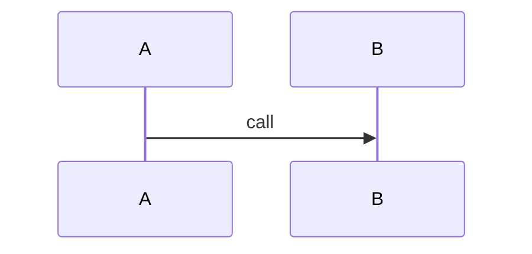

# PREFIX-NNN: one-line title (what breaks)

<!-- Copy to rcapa-<short-description>.md and add its row to README.md.
README.md in this directory says what each section must answer. Delete these
comments. References are fully qualified: swarm-routing/<repo>/issues/N links
with the text swarm-routing/<repo>#N; an ns-3 item a link with the text
nsnam/ns-3-dev#N to the full gitlab.com URL; never a bare number with a hash. -->

## Summary

| | |
|---|---|
| ID | PREFIX-NNN |
| RCAPA ticket | [swarm-routing/REPO#N](https://github.com/swarm-routing/REPO/issues/N): `[rcapa] PREFIX-NNN short description` |
| Status | open / fixed on `main` / fixed in vX.Y.Z |
| Releases | fails: vX.Y.Z (how published: release, Zenodo DOI, PyPI, vcpkg port); last good: vX.Y.Z; introduced by commit … |
| Found | YYYY-MM-DD, in swarm-routing/REPO#N |
| Last checked | YYYY-MM-DD (what was checked: a re-run, a source read) |
| Impact | who and what it touches: users of the release, published numbers, downstream pins |
| Fixed in | swarm-routing/REPO#N (the PR), release vX.Y.Z (DOI read from Zenodo) |

Two or three sentences: the defect and its effect.

## Problem and detection

What goes wrong, the symptom we saw, and how it was detected: the run, the
job, the report, the issue.

## Reproduction

```bash
# exact commands
```

- Release / commit: … (and an image by tag and digest if one is involved)
- Seed / run: …
- Expected (last good release): …
- Actual: …

## Root cause: five whys

1. **Why …?** … (evidence: `path/file.cc:NNN` at commit …; or a run, a comment)
2. **Why …?** …
3. **Why …?** …
4. **Why …?** …
5. **Why did our checks let it into a release?** …

## Diagrams

### Failing call chain



### Components involved


## Corrective actions

| Action | Where | Status |
|--------|-------|--------|
| … | swarm-routing/REPO#N | done / open |

## Preventive actions

| Action | Where | Status |
|--------|-------|--------|
| … | … | done / open (issue) |

## Timeline

| Date | Event |
|------|-------|
| YYYY-MM-DD | … |

## Links

- …
