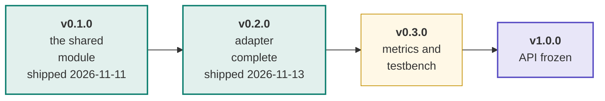
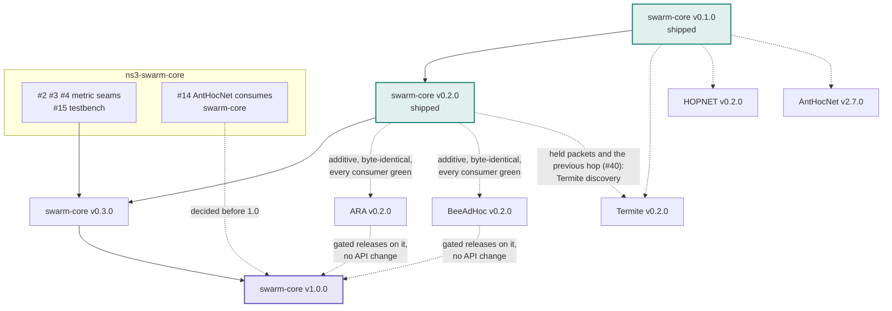

# Roadmap

The plan in one page: which release each piece of work serves, and what each
release must show to ship. The live plan is this page plus the `release:`
labels below; issue state is always truer than a checked-in diagram. The
org-wide view (the release train across repositories) is the
[org ROADMAP](https://github.com/swarm-routing/.github/blob/main/ROADMAP.md).

The ladder was adopted by the maintainer on 2026-11-11 ("adopt the release
ladder and replace the phase-targets rule"). It follows
[AntHocNet's roadmap](https://github.com/swarm-routing/AntHocNet/blob/main/docs/roadmap.md):
themed minor releases `vX.Y.0`, an exit-criteria table per release, a "what
blocks what" graph, an infrastructure track that rides along, and deliberate
non-goals.

## How this plan is tracked

Each issue a release gates carries a **`release:` label**, so every column of
this plan is a live query rather than a diagram that drifts:

| Release | Board |
|---|---|
| v0.1.0 | [`release:v0.1.0`](https://github.com/swarm-routing/ns3-swarm-core/issues?q=is%3Aopen+label%3A%22release%3Av0.1.0%22) |
| v0.2.0 | [`release:v0.2.0`](https://github.com/swarm-routing/ns3-swarm-core/issues?q=is%3Aopen+label%3A%22release%3Av0.2.0%22) |
| v0.3.0 | [`release:v0.3.0`](https://github.com/swarm-routing/ns3-swarm-core/issues?q=is%3Aopen+label%3A%22release%3Av0.3.0%22) |
| v1.0.0 | [`release:v1.0.0`](https://github.com/swarm-routing/ns3-swarm-core/issues?q=is%3Aopen+label%3A%22release%3Av1.0.0%22) |
| all epics | [`epic`](https://github.com/swarm-routing/ns3-swarm-core/issues?q=is%3Aopen+label%3Aepic) |

The labels are applied right after the `release:` labels land in the org
taxonomy, so a board can be empty or incomplete until then: read this page's
exit-criteria table for the gates in the meantime. The `release:v0.1.0` and
`release:v0.2.0` boards are empty: both have shipped and no open issue carries
their labels.

Only issues the ladder actually gates are labelled, one release label per
issue. Everything else is unscheduled work that lands whenever it lands.
Majors are reserved for breaking changes; 1.0.0 is the stability promise.

## Release ladder

Teal releases have shipped; amber releases are planned and not yet shipped.
**v0.1.0 shipped on 2026-11-11**
([release](https://github.com/swarm-routing/ns3-swarm-core/releases/tag/v0.1.0),
Zenodo version DOI
[10.5281/zenodo.24138629](https://doi.org/10.5281/zenodo.24138629)).
**v0.2.0 shipped on 2026-11-13**
([release](https://github.com/swarm-routing/ns3-swarm-core/releases/tag/v0.2.0),
Zenodo version DOI
[10.5281/zenodo.24184704](https://doi.org/10.5281/zenodo.24184704)). v0.3.0
is the next one.

## What blocks what

Solid arrows are hard dependencies; dashed are "informs / is consumed by".
Cross-repository issues are written `swarm-routing/<repo>#N`.

Teal boxes have shipped: v0.1.0 and v0.2.0 (whose four issues, #40, #33, #43
and #46, are closed).

The sequencing rule worth memorising: every protocol links `main`, so a
swarm-core release is only as good as its consumers' CI. v0.2.0 (tag
`v0.2.0` at `2fb52d2`, 2026-11-13) was additive; no consumer run was recorded
at `2fb52d2` itself. The nearest record: ARA's and BeeAdHoc's `ns-3` workflow
on their `main`, which builds swarm-core `main`, passed at 07:40 and 07:02 UTC
that day
([ARA run 43387381816](https://github.com/swarm-routing/ARA/actions/runs/43387381816),
[BeeAdHoc run 43382837899](https://github.com/swarm-routing/BeeAdHoc/actions/runs/43382837899)),
on swarm-core `71ab416`, whose changes since the tag (#104, #105, #106, #109)
touch build files, workflows and docs, no source under `core/` or `model/`.
1.0.0 needs two gated protocol releases built on it unchanged.

### The release train

swarm-core sits in the org's release train (waves A to E), adopted by the
maintainer on 2026-11-11. The org ROADMAP is being updated to carry it (it
replaces the phase-targets table); until that lands, this section is the
record of swarm-core's part:

- **A (now):** ns3-swarm-core v0.1.0 (shipped 2026-11-11), ns3-tools v0.1.0
  (shipped 2026-11-11), AntHocNet v2.7.0.
- **B:** ns3-swarm-core v0.2.0 (shipped 2026-11-13) with ns3-tools v0.2.0,
  then ARA v0.2.0 and BeeAdHoc v0.2.0 (the first gated protocol releases).
- **C, D:** Termite v0.2.0, then HOPNET v0.2.0, on swarm-core v0.2.0.
- **E:** 1.0.0s, swarm-core first (two gated protocols on it unchanged), then
  ns3-tools, then each protocol after its v0.3.0 review. This needs a
  `reusable-release.yml` `increment` input (MAJOR), a new ticket in
  swarm-routing/.github.

## What each release must show to ship

| Release | Exit criteria |
|---|---|
| **v0.1.0** "the shared module" (shipped 2026-11-11) | The module released through the org `reusable-release.yml`: `make dist` builds and checks the module tarball ([#38](https://github.com/swarm-routing/ns3-swarm-core/issues/38)). Epic [#6](https://github.com/swarm-routing/ns3-swarm-core/issues/6)'s third criterion is met (ARA and BeeAdHoc `ns3/` green against `main`, swarm-routing/ARA#40, swarm-routing/BeeAdHoc#48). |
| **v0.2.0** "adapter complete" (shipped 2026-11-13) | `SwarmRoutingBase` carries what the first gated protocols need: hold a packet with its protocol header and send one back to the previous hop ([#40](https://github.com/swarm-routing/ns3-swarm-core/issues/40), P1; ARA backtracking, Termite discovery); an optional entry lifetime on `DedupHistory` ([#33](https://github.com/swarm-routing/ns3-swarm-core/issues/33)); node shutdown, crash and restart with a helper that scripts failures identically for every arm ([#43](https://github.com/swarm-routing/ns3-swarm-core/issues/43)); the deferred queue and wire path without O(n²) rebuilds or per-packet allocation ([#46](https://github.com/swarm-routing/ns3-swarm-core/issues/46)). **Exit:** every change is additive, default output is byte-identical (same seed, same bytes), and every consumer (ARA, BeeAdHoc, the toy protocol in `test/`) is green. Released as tag `v0.2.0` (`2fb52d2`, 2026-11-13); the consumer check at that commit was not recorded, the nearest green consumer runs are named under "What blocks what". |
| **v0.3.0** "metrics and testbench" | The metric seams and the testbench: energy-aware `ILinkMetric` ([#2](https://github.com/swarm-routing/ns3-swarm-core/issues/2)), fuzzy composite `ILinkMetric` ([#3](https://github.com/swarm-routing/ns3-swarm-core/issues/3)), ISL neighbour discovery without hello ([#4](https://github.com/swarm-routing/ns3-swarm-core/issues/4)), and a shared discrete-event testbench for protocol cores ([#15](https://github.com/swarm-routing/ns3-swarm-core/issues/15)). |
| **v1.0.0** "API frozen" | `kSwarmCoreApiVersion` frozen with a written deprecation policy (#83); ARA and BeeAdHoc gated releases built on it with no API change; AntHocNet's `core/` and ns-3 adapter running on it ([#14](https://github.com/swarm-routing/ns3-swarm-core/issues/14): every protocol builds on swarm-core, maintainer decision 2026-11-12). The host contract for other simulators and real computers is **v2.0.0** ([#82](https://github.com/swarm-routing/ns3-swarm-core/issues/82); swarm-routing/.github#253). |

Issue state, read from the tracker on 2026-11-13: #38 is closed and v0.1.0 has
shipped; #40, #33, #43 and #46 (v0.2.0) are closed as completed and v0.2.0 has shipped; #2, #3, #4 and
#15 (v0.3.0), #14 and #83 (v1.0.0) are open, and their titles match the entries
above. Epic #6 is closed as completed; epic #82 is open.

Open and not on the ladder (no `release:` label, so no release waits for
them):

- [#96](https://github.com/swarm-routing/ns3-swarm-core/issues/96):
  `SwarmRoutingBase::RouteInput` reads a UDP header from every IPv4 fragment.
  Unscheduled: a fix lands when it lands, in whichever release is next.
- [#71](https://github.com/swarm-routing/ns3-swarm-core/issues/71) (a
  node-driver contract), [#72](https://github.com/swarm-routing/ns3-swarm-core/issues/72)
  (`NodeAddress` as an opaque node id) and
  [#73](https://github.com/swarm-routing/ns3-swarm-core/issues/73) (link
  signals as one port with fallbacks): sub-issues of epic
  [#82](https://github.com/swarm-routing/ns3-swarm-core/issues/82), the host
  contract, which is v2.0.0 (the v1.0.0 row above). They are unlabelled
  because the shared `release:` labels stop at v1.0.0.

## Infrastructure track

CI, packaging and tooling work rides along with the ladder under the same
`release:` labels where it has a natural home. It never changes behaviour, so
it never gates a release's exit criteria. The one item that gated a release,
[#38](https://github.com/swarm-routing/ns3-swarm-core/issues/38) (v0.1.0), is
closed and that release has shipped. ns-3
version drift is not tracked here: CI follows the release ns-3 supports with no
edit (org CONTRIBUTING invariant 7).

## After 1.0

The org plans themed lines after the 1.0.0 releases. They are recorded in the
[org ROADMAP](https://github.com/swarm-routing/.github/blob/main/ROADMAP.md), the
first three in `swarm-routing/ns3-tools`' own
[roadmap](https://github.com/swarm-routing/ns3-tools/blob/main/docs/roadmap.md#after-10):

- **1.1 comparators**: secure, learned and DTN arms, and AOMDV/GPSR promoted from AntHocNet ([ns3-tools#15](https://github.com/swarm-routing/ns3-tools/issues/15), [ns3-tools#34](https://github.com/swarm-routing/ns3-tools/issues/34));
- **1.2 network families**: the substrates new network types need ([ns3-tools#43](https://github.com/swarm-routing/ns3-tools/issues/43));
- **2.0 security**: adversary nodes ([ns3-tools#37](https://github.com/swarm-routing/ns3-tools/issues/37)) and the secure swarm variants ([ARA#9](https://github.com/swarm-routing/ARA/issues/9), [ARA#10](https://github.com/swarm-routing/ARA/issues/10), [BeeAdHoc#9](https://github.com/swarm-routing/BeeAdHoc/issues/9));
- **later**: more swarm protocols ([.github#54](https://github.com/swarm-routing/.github/issues/54)) and other simulators ([.github#48](https://github.com/swarm-routing/.github/issues/48), deferred).

**None of them gates any release of this repository before 1.0**, and none has
an issue here today: the arms and substrates live in `swarm-routing/ns3-tools`
and in each protocol repository. A primitive one of
them needs moves here only when a second protocol needs it too (rule 11), as an
additive minor release.

## Deliberate non-goals

- **No protocol logic.** swarm-core holds what two or more protocols share
  (AGENTS.md rule 11). A protocol's decision rules live in its own repository.
- **No 1.0 before two gated protocols run on it.** The API is frozen by
  evidence from ARA and BeeAdHoc, not by design alone.
- **No breaking change before 1.0 without the downstream fixes.** A breaking
  API change lands with the consumers' fixes or an issue in each (AGENTS.md
  rule 12).

## See also

- [Org ROADMAP](https://github.com/swarm-routing/.github/blob/main/ROADMAP.md): the release train across repositories.
- [CONTRIBUTING](https://github.com/swarm-routing/.github/blob/main/CONTRIBUTING.md): invariants, issue and label taxonomy.
- [AntHocNet's roadmap](https://github.com/swarm-routing/AntHocNet/blob/main/docs/roadmap.md): the shape this page follows.
- [Epic #6](https://github.com/swarm-routing/ns3-swarm-core/issues/6): the shared module.
