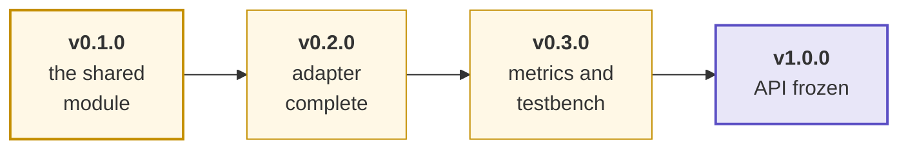
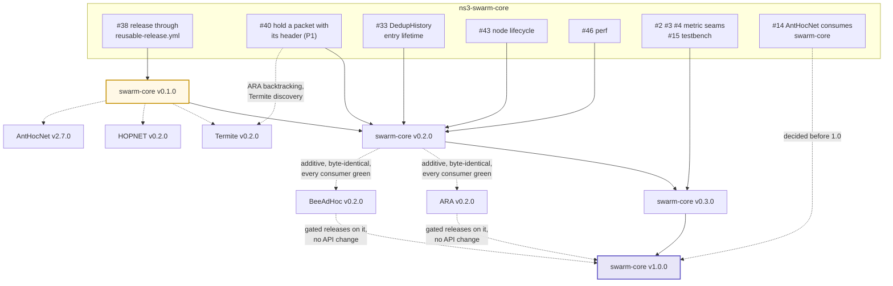

# Roadmap

The plan in one page: which release each piece of work serves, and what each
release must show to ship. The live plan is this page plus the `release:`
labels below; issue state is always truer than a checked-in diagram. The
org-wide view (the release train across repositories) is the
[org ROADMAP](https://github.com/swarm-routing/.github/blob/main/ROADMAP.md).

The ladder was adopted by the maintainer on 2026-11-11 ("adopt the release
ladder and replace the phase-targets rule"). It follows
[AntHocNet's roadmap](https://github.com/swarm-routing/AntHocNet/blob/main/docs/roadmap.md):
themed minor releases `vX.Y.0`, an exit-criteria table per release, a "what
blocks what" graph, an infrastructure track that rides along, and deliberate
non-goals.

## How this plan is tracked

Each issue a release gates carries a **`release:` label**, so every column of
this plan is a live query rather than a diagram that drifts:

| Release | Board |
|---|---|
| v0.1.0 | [`release:v0.1.0`](https://github.com/swarm-routing/ns3-swarm-core/issues?q=is%3Aopen+label%3A%22release%3Av0.1.0%22) |
| v0.2.0 | [`release:v0.2.0`](https://github.com/swarm-routing/ns3-swarm-core/issues?q=is%3Aopen+label%3A%22release%3Av0.2.0%22) |
| v0.3.0 | [`release:v0.3.0`](https://github.com/swarm-routing/ns3-swarm-core/issues?q=is%3Aopen+label%3A%22release%3Av0.3.0%22) |
| v1.0.0 | [`release:v1.0.0`](https://github.com/swarm-routing/ns3-swarm-core/issues?q=is%3Aopen+label%3A%22release%3Av1.0.0%22) |
| all epics | [`epic`](https://github.com/swarm-routing/ns3-swarm-core/issues?q=is%3Aopen+label%3Aepic) |

The labels are applied right after the `release:` labels land in the org
taxonomy, so a board can be empty or incomplete until then: read this page's
exit-criteria table for the gates in the meantime.

Only issues the ladder actually gates are labelled, one release label per
issue. Everything else is unscheduled work that lands whenever it lands.
Majors are reserved for breaking changes; 1.0.0 is the stability promise.

## Release ladder

Amber releases are planned and not yet shipped; nothing has shipped yet (no
GitHub release exists as of 2026-11-11). v0.1.0 is the next one and waits only
on [#38](https://github.com/swarm-routing/ns3-swarm-core/issues/38).

## What blocks what

Solid arrows are hard dependencies; dashed are "informs / is consumed by".
Cross-repository issues are written `swarm-routing/<repo>#N`.

The sequencing rule worth memorising: every protocol links `main`, so a
swarm-core release is only as good as its consumers' CI. v0.2.0 is additive
and byte-identical for the existing consumers (ARA, BeeAdHoc) before it ships;
1.0.0 needs two gated protocol releases built on it unchanged.

### The release train

swarm-core sits in the org's release train (waves A to E), adopted by the
maintainer on 2026-11-11. The org ROADMAP is being updated to carry it (it
replaces the phase-targets table); until that lands, this section is the
record of swarm-core's part:

- **A (now):** ns3-swarm-core v0.1.0 (#38), ns3-tools v0.1.0 (after the
  tag-push fix swarm-routing/ns3-tools#105), AntHocNet v2.7.0.
- **B:** ns3-swarm-core v0.2.0 with ns3-tools v0.2.0, then ARA v0.2.0 and
  BeeAdHoc v0.2.0 (the first gated protocol releases).
- **C, D:** Termite v0.2.0, then HOPNET v0.2.0, on swarm-core v0.2.0.
- **E:** 1.0.0s, swarm-core first (two gated protocols on it unchanged), then
  ns3-tools, then each protocol after its v0.3.0 review. This needs a
  `reusable-release.yml` `increment` input (MAJOR), a new ticket in
  swarm-routing/.github.

## What each release must show to ship

| Release | Exit criteria |
|---|---|
| **v0.1.0** "the shared module" | The module released through the org `reusable-release.yml`: `make dist` builds and checks the module tarball ([#38](https://github.com/swarm-routing/ns3-swarm-core/issues/38)). Epic [#6](https://github.com/swarm-routing/ns3-swarm-core/issues/6)'s third criterion is met (ARA and BeeAdHoc `ns3/` green against `main`, swarm-routing/ARA#40, swarm-routing/BeeAdHoc#48). |
| **v0.2.0** "adapter complete" | `SwarmRoutingBase` carries what the first gated protocols need: hold a packet with its protocol header and send one back to the previous hop ([#40](https://github.com/swarm-routing/ns3-swarm-core/issues/40), P1; ARA backtracking, Termite discovery); an optional entry lifetime on `DedupHistory` ([#33](https://github.com/swarm-routing/ns3-swarm-core/issues/33)); node shutdown, crash and restart with a helper that scripts failures identically for every arm ([#43](https://github.com/swarm-routing/ns3-swarm-core/issues/43)); the deferred queue and wire path without O(n²) rebuilds or per-packet allocation ([#46](https://github.com/swarm-routing/ns3-swarm-core/issues/46)). **Exit:** every change is additive, default output is byte-identical (same seed, same bytes), and every consumer (ARA, BeeAdHoc, the toy protocol in `test/`) is green. |
| **v0.3.0** "metrics and testbench" | The metric seams and the testbench: energy-aware `ILinkMetric` ([#2](https://github.com/swarm-routing/ns3-swarm-core/issues/2)), fuzzy composite `ILinkMetric` ([#3](https://github.com/swarm-routing/ns3-swarm-core/issues/3)), ISL neighbour discovery without hello ([#4](https://github.com/swarm-routing/ns3-swarm-core/issues/4)), and a shared discrete-event testbench for protocol cores ([#15](https://github.com/swarm-routing/ns3-swarm-core/issues/15)). |
| **v1.0.0** "API frozen" | `kSwarmCoreApiVersion` frozen with a written deprecation policy; ARA and BeeAdHoc gated releases built on it with no API change; whether AntHocNet consumes swarm-core at switch-over decided ([#14](https://github.com/swarm-routing/ns3-swarm-core/issues/14)). |

Issue state at the time of writing (2026-11-11): #38, #40, #33, #43, #46, #2,
#3, #4, #15 and #14 are all open, and their titles match the entries above.
Epic #6 is still open although its acceptance criteria are all met; closing it
is a maintainer step.

## Infrastructure track

CI, packaging and tooling work rides along with the ladder under the same
`release:` labels where it has a natural home. It never changes behaviour, so
it never gates a release's exit criteria. The one item that gates a release is
[#38](https://github.com/swarm-routing/ns3-swarm-core/issues/38) (v0.1.0). ns-3
version drift is not tracked here: CI follows the release ns-3 supports with no
edit (org CONTRIBUTING invariant 7).

## Deliberate non-goals

- **No protocol logic.** swarm-core holds what two or more protocols share
  (AGENTS.md rule 11). A protocol's decision rules live in its own repository.
- **No 1.0 before two gated protocols run on it.** The API is frozen by
  evidence from ARA and BeeAdHoc, not by design alone.
- **No breaking change before 1.0 without the downstream fixes.** A breaking
  API change lands with the consumers' fixes or an issue in each (AGENTS.md
  rule 12).

## See also

- [Org ROADMAP](https://github.com/swarm-routing/.github/blob/main/ROADMAP.md): the release train across repositories.
- [CONTRIBUTING](https://github.com/swarm-routing/.github/blob/main/CONTRIBUTING.md): invariants, issue and label taxonomy.
- [AntHocNet's roadmap](https://github.com/swarm-routing/AntHocNet/blob/main/docs/roadmap.md): the shape this page follows.
- [Epic #6](https://github.com/swarm-routing/ns3-swarm-core/issues/6): the shared module.
